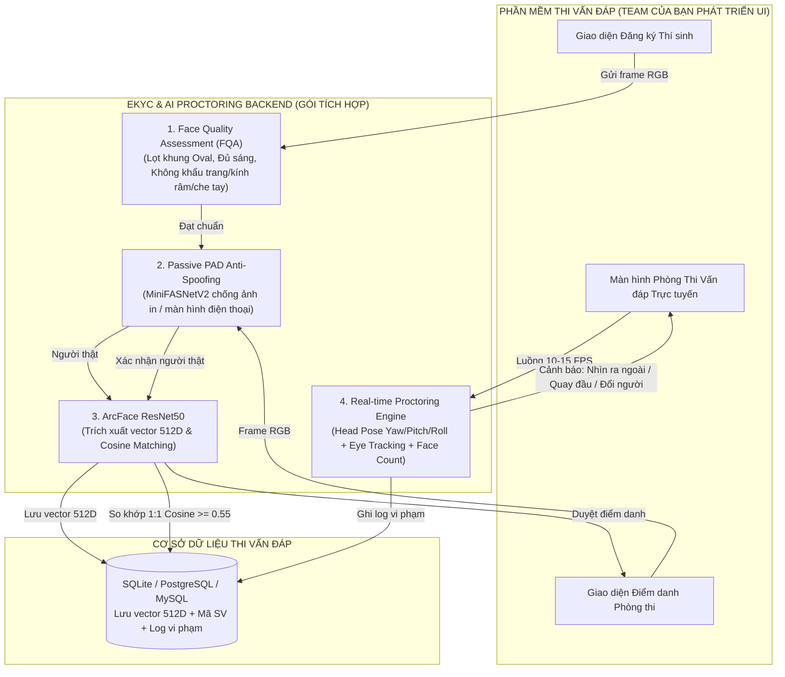

# 🚀 EKYC & AI PROCTORING INTEGRATION KIT
## Tài Liệu Tích Hợp Hệ Thống eKYC & Giám Thị AI Vào Phần Mềm Thi Vấn Đáp

> **Dành cho:** Đội ngũ phát triển Backend / Core phần mềm Thi Vấn Đáp  
> **Mục tiêu:** Cung cấp đầy đủ mô hình AI, thư viện, mã nguồn mẫu và kiến trúc tích hợp trọn gói cho 3 nghiệp vụ cốt lõi:
> 1. **Đăng ký hồ sơ sinh trắc học thí sinh (Enrollment)**
> 2. **Xác thực danh tính & Điểm danh vào phòng thi (Check-in Verification)**
> 3. **Giám thị thông minh trong suốt quá trình thi (In-Exam AI Proctoring: Tracking mắt, góc quay đầu, phát hiện đổi người/gian lận)**

---

## 📂 Danh Mục Tài Liệu Chi Tiết

| File | Nội dung chính |
| :--- | :--- |
| **[`01_MODELS_AND_DEPENDENCIES.md`](./01_MODELS_AND_DEPENDENCIES.md)** | Bảng thông số chi tiết các model AI, danh sách thư viện `pip`, yêu cầu phần cứng & cấu trúc thư mục đóng gói ZIP |
| **[`02_EXAM_INTEGRATION_WORKFLOW.md`](./02_EXAM_INTEGRATION_WORKFLOW.md)** | Thiết kế kiến trúc & luồng dữ liệu 3 pha cho phần mềm thi vấn đáp: Đăng ký -> Điểm danh -> Giám sát phòng thi |
| **[`03_CODE_COOKBOOK.md`](./03_CODE_COOKBOOK.md)** | Hướng dẫn lập trình thực chiến (Copy-Paste là chạy) cho: MediaPipe FaceMesh, Head Pose, Eye Tracking, MiniFASNet, ArcFace 512D |
| **[`04_POLICY_AND_FQA_RULES.md`](./04_POLICY_AND_FQA_RULES.md)** | Bộ quy chuẩn chất lượng khuôn mặt (FQA Policy): Tiêu chuẩn cấm khẩu trang, kính râm, che tay, góc nghiêng, cự ly và thông điệp UI/UX |
| **[`05_CAMERA_AND_LIGHTING_CHECK.md`](./05_CAMERA_AND_LIGHTING_CHECK.md)** | Kiểm tra phần cứng camera: Phát hiện camera đen, đóng băng, phân giải thấp, nhiễu hạt & Thuật toán tự động tăng sáng CLAHE thích ứng |
| **[`06_LESSONS_LEARNED_AND_BEST_PRACTICES.md`](./06_LESSONS_LEARNED_AND_BEST_PRACTICES.md)** | Bài học kinh nghiệm & thủ thuật thực chiến: Khử nghẽn FPS, chống giả mạo đa tầng, tránh chặn nhầm người thật (FRR) và xử phạt leo thang |
| **[`quick_start_demo.py`](./quick_start_demo.py)** | File mã nguồn Python độc lập hoàn chỉnh, chạy thử nghiệm trực tiếp trên Webcam máy tính |

---

## 🏛️ Sơ Đồ Kiến Trúc Hệ Thống (Architecture Flow)



---

## ⚡ Hướng Dẫn Bắt Đầu Nhanh (Quick Start in 3 Steps)

### Bước 1: Cài đặt môi trường Python
Yêu cầu **Python 3.9, 3.10 hoặc 3.11** (khuyên dùng Python 3.10 64-bit):

```bash
pip install opencv-python>=4.9.0 mediapipe==0.10.14 onnxruntime>=1.16.0 numpy>=1.24.0,<2.0.0
```

### Bước 2: Bố trí file Model
Giải nén gói tài nguyên được cung cấp, đặt 2 file mô hình ONNX vào thư mục `models/`:
- `models/w600k_r50.onnx` (ArcFace ResNet50 - 174 MB)
- `models/minifasnet_v2.onnx` (MiniFASNetV2 Liveness - 1.7 MB)

### Bước 3: Chạy thử file Demo hoàn chỉnh
Mở terminal tại thư mục chứa kit và chạy:

```bash
python quick_start_demo.py
```

Cửa sổ camera sẽ hiển thị trực quan:
- **Khung lưới sinh trắc học 468 điểm**
- **Trục tọa độ 3D Head Pose (Yaw, Pitch, Roll)**
- **Tia nhìn mắt (Gaze Vector) và cảnh báo nhìn ra ngoài màn hình**
- **Điểm số người thật (Anti-Spoofing Score)**
- **Vector đặc trưng 512D ArcFace**
